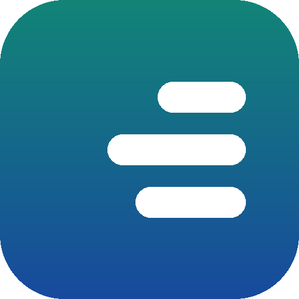
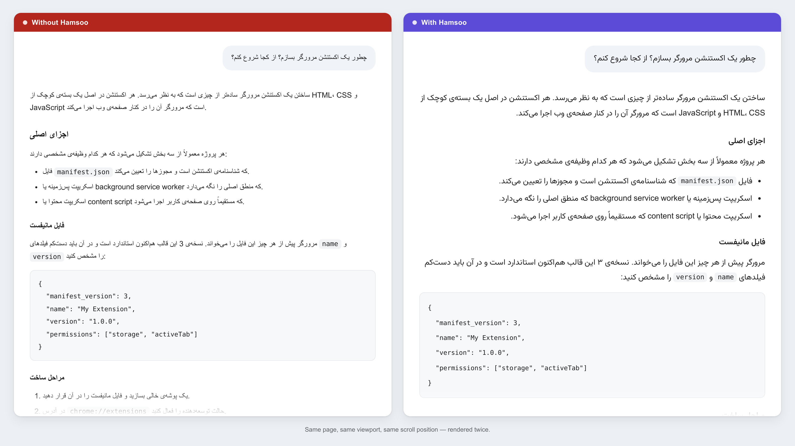
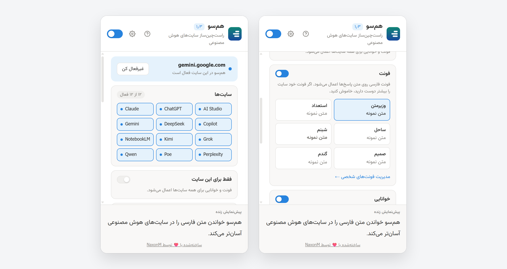
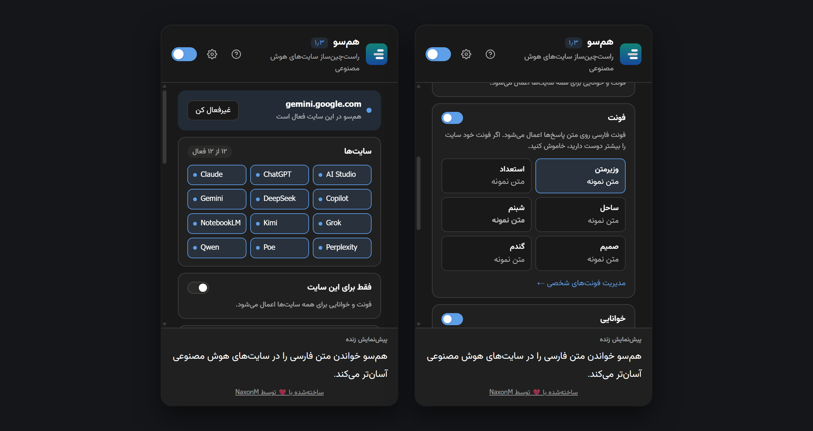
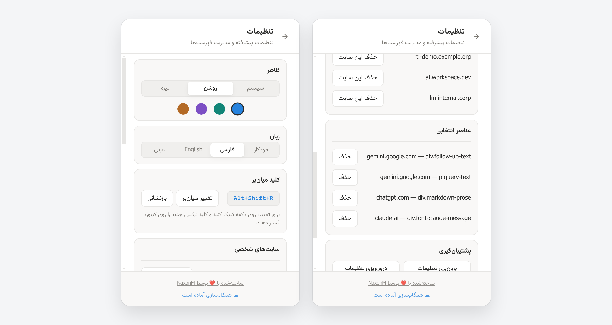
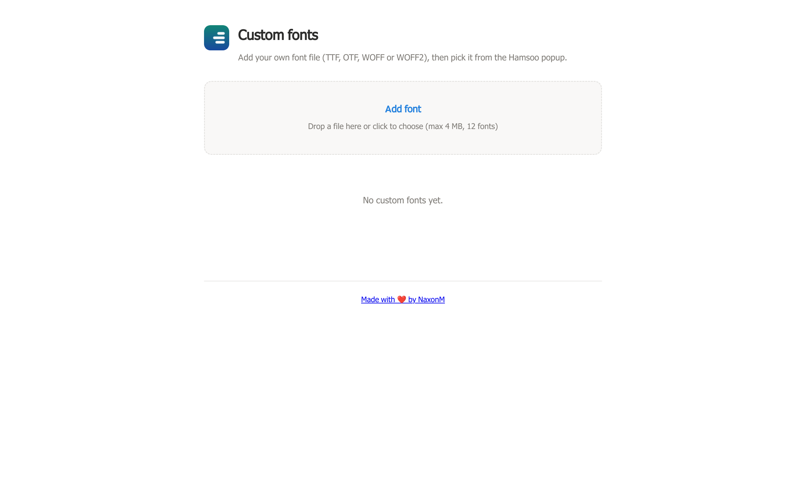
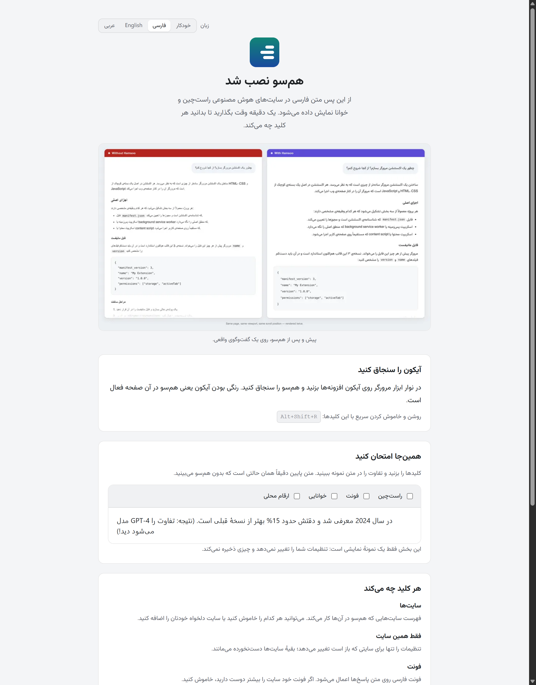

<div align="center">



# هم‌سو &nbsp;·&nbsp; Hamsoo

**اصلاح تایپوگرافی و راست‌چین برای رابط‌های گفتگوی هوش مصنوعی.**

بسیاری از سرویس‌های هوش مصنوعی متون فارسی را چپ‌چین، با فونت‌های نامناسب و نشانه‌های نگارشی جابجا نمایش می‌دهند. هم‌سو جهت متن، فونت و فاصلهٔ سطرها را مستقیماً در مرورگر شما اصلاح می‌کند، بدون آنکه تغییری در محتوای گفتگو ایجاد کند.

[](https://addons.mozilla.org/en-US/firefox/addon/hamsoo-%D9%87%D9%85-%D8%B3%D9%88/)
[](#نصب)
[](LICENSE)
[](hamsoo-addon/package.json)
[](#توسعه)

**[English](README.md)** · [پیش‌نمایش زنده](https://naxonm.github.io/hamsoo) · [تغییرات نسخه‌ها](hamsoo-addon/CHANGELOG.md)

</div>

---



---

<div dir="rtl" align="right">

[امکانات](#امکانات) ·
[تصویرها](#تصویرها) ·
[سایت‌های پشتیبانی‌شده](#سایت‌های-پشتیبانی‌شده) ·
[نصب](#نصب) ·
[تنظیمات](#تنظیمات) ·
[حریم خصوصی](#حریم-خصوصی) ·
[توسعه](#توسعه) ·
[مجوز](#مجوز)

---

## امکانات

### جهت متن و چیدمان
* **تشخیص خودکار جهت متن (RTL)**: تعیین جهت پایه برای هر پاراگراف طبق استاندارد `dir="auto"` (نخستین حرف قوی)، همراه با به‌روزرسانی هنگام دریافت پاسخ‌های جریانی.
* **مدیریت متون ترکیبی**: سطرهای فارسی حاوی کلمات انگلیسی بدون جابجایی یا برعکس شدن کلمات نمایش داده می‌شوند.
* **حفظ ساختار کد**: بلوک‌های کد (`pre` و `code`)، پیوندها و نشانی‌های وب همیشه چپ‌به‌راست می‌مانند.
* **تنظیم کادر ورودی**: اعمال جهت مناسب روی کادر تایپ از نخستین کلید فشارداده‌شده.
* **تبدیل اعداد**: امکان تبدیل اختیاری اعداد به فارسی (`۱۲۳`) یا عربی (`١٢٣`).

### تایپوگرافی و خوانایی
* **فونت‌های فارسی همراه**: شامل وزیرمتن، استعداد، ساحل، شبنم، صمیم و گندم.
* **افزودن فونت دلخواه**: پشتیبانی از بارگذاری تا ۱۲ فایل فونت شخصی (`.woff2` ،`.ttf` ،`.otf`).
* **تنظیمات دقیق خوانایی**: تغییر اندازهٔ قلم، فاصلهٔ سطرها، ضخامت متن، فاصلهٔ حروف، چینش و عرض ستون مطالعه.
* **تنظیمات اختصاصی هر سایت**: ذخیرهٔ تنظیمات تایپوگرافی متفاوت برای دامنه‌های گوناگون.

### مدیریت و کاربری
* **خاموش/روشن آنی**: فعال و غیرفعال‌سازی بدون نیاز به بارگذاری مجدد صفحه.
* **کلید میان‌بر**: `Alt+Shift+R` (قابل تغییر در تنظیمات مرورگر).
* **افزودن سایت دلخواه و انتخابگر عنصر**: فعال‌سازی روی هر دامنه یا انتخاب عناصر خاصی از صفحه برای اصلاح.
* **پشتیبان‌گیری**: خروجی و ورود فایل تنظیمات، شامل فونت‌های شخصی.
* **رابط چندزبانه**: پشتیبانی کامل از زبان‌های فارسی، انگلیسی و عربی همراه با پوستهٔ تیره (Dark Mode).

---

## تصویرها

</div>

<table>
  <tr>
    <td width="50%"></td>
    <td width="50%"></td>
  </tr>
  <tr>
    <td align="center"><sub><b>پنجرهٔ اصلی</b> — کنترل‌های سریع</sub></td>
    <td align="center"><sub><b>پنجرهٔ اصلی</b> — پوستهٔ تیره</sub></td>
  </tr>
  <tr>
    <td width="50%"></td>
    <td width="50%"></td>
  </tr>
  <tr>
    <td align="center"><sub><b>تنظیمات</b> — دامنه‌ها و پشتیبان‌گیری</sub></td>
    <td align="center"><sub><b>مدیریت فونت</b> — فونت‌های شخصی</sub></td>
  </tr>
  <tr>
    <td colspan="2"></td>
  </tr>
  <tr>
    <td colspan="2" align="center"><sub><b>راهنمای آشنایی</b> — آموزش تعاملی پس از نصب اولیه</sub></td>
  </tr>
</table>

<div dir="rtl" align="right">

تصویر مقایسه‌ای عمودی برای نمایشگرهای کم‌عرض در فایل [`assets/screenshots/comparison-stacked.png`](assets/screenshots/comparison-stacked.png) قرار دارد.

---

## سایت‌های پشتیبانی‌شده

سرویس‌های پیش‌فرض:

| | | |
| :--- | :--- | :--- |
| ChatGPT (`chatgpt.com`) | Claude (`claude.ai`) | Gemini (`gemini.google.com`) |
| DeepSeek (`chat.deepseek.com`) | Grok (`grok.com`) | Perplexity (`perplexity.ai`) |
| Copilot (`copilot.microsoft.com`) | AI Studio (`aistudio.google.com`) | Qwen (`chat.qwen.ai`) |
| Kimi (`kimi.moonshot.cn` ،`kimi.com`) | Poe (`poe.com`) | NotebookLM (`notebooklm.google.com`) |

با گزینهٔ **افزودن این سایت** در پنجرهٔ افزونه می‌توانید هم‌سو را روی هر دامنه یا سرور توسعهٔ محلی نیز فعال کنید.

---

## نصب

### مرورگر فایرفاکس (پیشنهادی)
نصب مستقیم از **[مخزن افزونه‌های فایرفاکس (AMO)](https://addons.mozilla.org/en-US/firefox/addon/hamsoo-%D9%87%D9%85-%D8%B3%D9%88/)**.

### مرورگرهای مبتنی بر کرومیوم (Chrome, Edge, Brave, Opera)
۱. دریافت کد و ساخت:
   ```bash
   git clone https://github.com/NaxonM/hamsoo.git
   cd hamsoo/hamsoo-addon
   npm run build
   ```
۲. ورود به `chrome://extensions` (یا `edge://extensions`) و فعال‌سازی **Developer mode**.
۳. انتخاب **Load unpacked** و گزینش پوشهٔ `dist/hamsoo-chromium`.

همچنین می‌توانید فایل `hamsoo-chromium.zip` را از بخش [Releases](https://github.com/NaxonM/hamsoo/releases) دریافت کرده و از حالت فشرده خارج کنید.

---

## تنظیمات

| تنظیم | بازه | پیش‌فرض |
| :--- | :--- | :--- |
| اندازهٔ قلم | ۱۲ تا ۲۲ پیکسل | ۱۵ |
| فاصلهٔ سطرها | ۱٫۳ تا ۲٫۵ | ۱٫۹ |
| ضخامت قلم | ۳۰۰ تا ۸۰۰ | ۴۰۰ |
| فاصلهٔ حروف | ۰ تا ۱٫۵ پیکسل | ۰ |
| عرض ستون مطالعه | ۴۰ تا ۱۰۰ نویسه، یا خاموش | خاموش |
| چینش متن | شروع یا هم‌تراز (Justified) | شروع |
| سبک اعداد | فارسی (`۱۲۳`) یا عربی (`١٢٣`) | فارسی |
| زبان رابط | خودکار، فارسی، انگلیسی، عربی | خودکار |

---

## حریم خصوصی

هم‌سو کاملاً به صورت محلی در مرورگر شما اجرا می‌شود و هیچ‌گونه ابزار آمارگیری، تله‌متری یا درخواست شبکه‌ای ندارد.

* `storage`, `unlimitedStorage`: ذخیره‌سازی تنظیمات و فونت‌های شخصی.
* `contextMenus`: منوی راست‌کلیک برای انتخاب عناصر.
* `activeTab`, `scripting`: اعمال استایل به زبانهٔ فعال.
* `*://*/*` (*اختیاری*): فقط هنگام افزودن دستی یک سایت جدید درخواست می‌شود.

---

## توسعه

بدون وابستگی به کتابخانه‌های خارجی (صفر dependency).

```bash
cd hamsoo-addon

npm run check         # اعتبارسنجی نحو، مانیفست و ترجمه‌ها
npm run build         # ساخت نسخهٔ کرومیوم و فایرفاکس
npm test              # اجرای ۳۵۱ آزمون خودکار
npm run verify        # بررسی کامل (check + build + test)
npm run zip           # بسته‌بندی فایل‌های انتشار
npm run preview       # تولید تصویرهای پیش‌نمایش
```

**ساختار پروژه**

* `hamsoo-addon/src/`: کد اصلی افزونه.
* `hamsoo-addon/test/`: مجموعهٔ آزمون‌ها.
* `hamsoo-addon/scripts/`: ابزارهای ساخت و بررسی.
* `hamsoo-addon/website/`: وب‌سایت افزونه.
* `assets/`: مستندات و تصویرها.
* `docs/HANDOVER.md` / `docs/GROUND-TRUTH.md`: کار باز فعلی (H01–H15).
* `docs/DEBUGGING-REPORT.md`: دفتر تاریخی رگرسیون R1–R6.

---

## مشارکت و مجوز

گزارش اشکال و درخواست‌های تغییر پذیرفته می‌شود. لطفاً پیش از ارسال تغییرات، `npm run verify` را اجرا کنید.

فونت‌های همراه: **وزیرمتن**، **استعداد**، **ساحل**، **شبنم**، **صمیم** و **گندم** (تحت مجوز OFL / SIL).

توسعه‌یافته توسط **[NaxonM](https://github.com/NaxonM)** تحت مجوز [AGPL-3.0-or-later](LICENSE).

</div>
